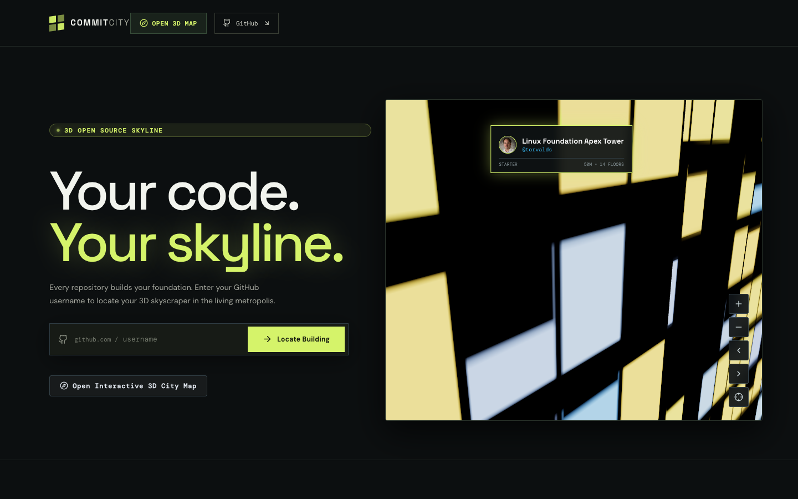

# COMMIT CITY (Comity)

> **Transform your GitHub contributions into a living, interactive 3D metropolis.**

[](https://comity-seven.vercel.app/)
[](https://github.com/Deepak-Kambala/Comity)
[](https://nextjs.org/)
[](https://threejs.org/)
[](https://github.com/Deepak-Kambala/Comity/actions/workflows/city-sync.yml)

---

[](https://comity-seven.vercel.app/)

---

## About

Commit City (Comity) is a high-performance 3D procedural metropolis that maps GitHub profiles and open-source contributions into architectural skyscrapers. Each building's elevation, architectural styling, and zoning reflect real-world developer metrics, accompanied by GTA-style minimap radar telemetry, instant skyscraper pinpointing with skyward beacons, and smooth 60 FPS WebGL navigation.

---

## Live Demo

- **Live Application**: [https://comity-seven.vercel.app/](https://comity-seven.vercel.app/)
- **Repository**: [https://github.com/Deepak-Kambala/Comity](https://github.com/Deepak-Kambala/Comity)

---

## Architecture Pipeline

```text
[ GitHub User / Org Telemetry ]
           |
           v
[ Metric Normalization & Zoning Engine ]
   ├── Public Repositories  -->  Elevation & Floor Count (3.5m / Story)
   ├── Aggregate Star Count -->  Rooftop Crown Billboard & Helipad Tier
   ├── Primary Tech Stack   -->  District Placement & Window Emissive Color
   └── CI/CD Health Status  -->  Skyward Laser Beacon & Waypoint Beacon
           |
           v
[ Procedural Texture Generation ]
   ├── High-Contrast Asphalt & Crosswalk Canvases
   ├── Multi-Tier Emissive Glass Matrices
   └── Double-Sided Illuminated Rooftop Signage
           |
           v
[ Three.js Direct WebGL Engine ]
   ├── ACESFilmic Tone Mapping (Exposure: 1.15)
   ├── Distance Linear Fog & 800-Star Celestial Dome
   ├── Dynamic Highway Traffic with Forward Headlights & Taillights
   └── GTA-Style Rotating Minimap HUD with Compass Orientation
```

---

## City Districts

The metropolis is organized into four designated engineering sectors:

| District | Focus Area | Anchor Tenants | Architectural Style |
| :--- | :--- | :--- | :--- |
| **01. Systems & Core** | Low-level engines, operating systems, and kernel infrastructure | Linux Foundation, Rust Foundation, Go Core | Heavy monolithic obsidian towers with emerald window arrays |
| **02. Web & Frameworks** | Modern web runtimes, rendering engines, and frontend frameworks | Vercel, Meta Open Source, Vue Core, Vite | Sleek neo-glass spires with azure illuminated crowns |
| **03. Cloud & Platforms** | Distributed systems, container orchestrators, and edge networks | Kubernetes, Docker, CNCF, Cloudflare | Industrial grid high-rises with dual rooftop helipads |
| **04. AI & Applied Data** | Deep learning runtimes, weights repositories, and neural tooling | Hugging Face, PyTorch, OpenAI open models | Futuristic illuminated towers with high-frequency laser beacons |

---

## Graphics & Performance Optimization

To deliver console-grade fidelity while maintaining a strict 60 FPS budget on standard laptops and mobile devices, Commit City implements:

- **Zero Forward-Light Penalty**: Skyscraper windows use canvas-generated emissive maps rather than expensive dynamic `PointLight` instances, avoiding GPU light loop degradation.
- **Scroll Protection**: WebGL OrbitControls disables vertical wheel zoom on the landing hero canvas, allowing users to scroll the page naturally without getting trapped.
- **Screen-Space Projection**: Skyscraper HUD cards and crowns are projected from 3D world coordinates (`Vector3.project(camera)`) into screen space with automated frustum culling.
- **Procedural Canvas Textures**: Road grids, lane dividers, crosswalks, and window illumination matrices are rendered dynamically in-memory via HTML Canvas, eliminating external image asset requests.

---

## Developer Telemetry API

Commit City exposes a serverless telemetry endpoint for querying developer metrics and computed building specifications:

```http
GET /api/github/:username
```

### Sample Response

```json
{
  "username": "torvalds",
  "name": "Linus Torvalds",
  "avatarUrl": "https://avatars.githubusercontent.com/u/1024025?v=4",
  "buildingName": "Kernel Systems Tower",
  "address": "400 Linux Way, District 01",
  "district": "systems",
  "height": 180,
  "floors": 51,
  "topLanguage": "C",
  "totalStars": 184500,
  "ciStatus": "passing",
  "verified": true
}
```

---

## Features

- **Photorealistic 3D Metropolis**:
  - Direct WebGL rendering with `ACESFilmicToneMapping` locked at 60 FPS.
  - Realistic procedural skyscraper architectures with emissive window matrices, illuminated crown billboards, rooftop helipads, and atmospheric linear fog.
  - Expansive coastal ocean plane with night reflection and an 800-star celestial dome.
  - Real-time animated traffic system with directional headlights and taillights.

- **Instant Skyscraper Highlighting**:
  - Search any GitHub username to immediately zoom into their custom building.
  - Custom skyward laser beacon and pulsating ground waypoint ring pinpoint the developer's tower.
  - Building height, floor count, and district zoning are dynamically derived from real repository count and community metrics.

- **GTA-Style Minimap HUD & Navigation**:
  - Live rotating compass radar in the corner with real-time player and waypoint blips.
  - Seamless mouse orbit, two-finger swipe, arrow key (`←` / `→` / `A` / `D`), and on-screen camera controls.
  - Page scroll protection: no wheel hijacking on landing preview.

- **Factual Open Source Titans**:
  - Zero generic lot names. The skyline features factual tech foundations and open-source leaders (Linux Foundation, Meta Open Source, Vercel, Rust Foundation, Kubernetes, Vue, Vite, and more).

- **Automated Live CI Telemetry**:
  - Serverless API route (`/api/github/[username]`) fetching real-time developer profiles, aggregate star counts, and top languages.
  - Scheduled GitHub Actions workflow (`.github/workflows/city-sync.yml`) refreshing telemetry every 6 hours.

- **Real-time Time of Day**:
  - Instant toggle between **Obsidian Midnight** (cyberpunk city lights) and **Miami Noon** (crisp high-noon sunlight).

---

## Tech Stack

- **Framework**: [Next.js 15 (App Router)](https://nextjs.org/)
- **UI Library**: [React 19](https://react.dev/)
- **3D Engine**: [Three.js](https://threejs.org/)
- **Icons**: [Lucide React](https://lucide.dev/)
- **Language**: [TypeScript 5](https://www.typescriptlang.org/)
- **Styling**: Modern CSS with CSS Variables & Glassmorphism

---

## Quick Start (Local Setup)

### 1. Clone the repository
```bash
git clone https://github.com/Deepak-Kambala/Comity.git
cd Comity
```

### 2. Install dependencies
```bash
npm install
```

### 3. Run development server
```bash
npm run dev
```

Open [http://localhost:3000](http://localhost:3000) in your browser.

### 4. Build for production
```bash
npm run build
npm run start
```

---

## Controls

| Action | Control |
| :--- | :--- |
| **Orbit Camera** | Left-click + drag / Two-finger swipe / `←` `→` / `A` `D` |
| **Pan Camera** | Right-click + drag / Two-finger drag |
| **Zoom In / Out** | Mouse wheel (Full map) / `+` `-` buttons on HUD |
| **Re-center on Building** | Crosshair button on HUD |
| **Toggle Day / Night** | Sun / Moon button in top bar |
| **Inspect Skyscraper** | Click any building or radar blip |

---

## License

MIT License © 2026 Deepak Kambala
